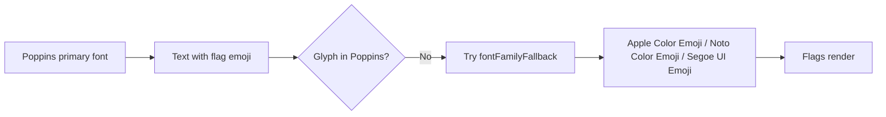

# Flag emoji “tofu” on iOS — analysis and next steps

## What the screenshots show

- Each dropdown row shows **two** replacement glyphs (boxes with “?”). Flag emojis are **two** [Regional Indicator Symbol](https://en.wikipedia.org/wiki/Regional_Indicator_Symbol) code points that the renderer should combine into one flag. When the **active font has no glyphs** for those code points, you see **two** missing glyphs — exactly matching your UI.
- Country **names** and **dial codes** render fine because Poppins covers Latin digits and letters.
- Your **Mac mini / macOS build** (Tahoe 26.x in the screenshot) is unusually new; **beta OS + Simulator** can add rare rendering quirks, but the **double-tofu pattern** still points first to **font coverage / fallback**, not to “wrong data” in [`country_codes.dart`](c:\Tarang\programming\flutter\smruti_sharing_workspace\smruti_sharing_mobile\lib\src\core\constants\country_codes.dart).

## What the project is doing

| Area                                                                                                                                                                                                                                                                                                                                                                        | Finding                                                                                                                                                                |
| --------------------------------------------------------------------------------------------------------------------------------------------------------------------------------------------------------------------------------------------------------------------------------------------------------------------------------------------------------------------------- | ---------------------------------------------------------------------------------------------------------------------------------------------------------------------- |
| [`app_theme.dart`](c:\Tarang\programming\flutter\smruti_sharing_workspace\smruti_sharing_mobile\lib\src\core\theme\app_theme.dart)                                                                                                                                                                                                                                          | `textTheme: GoogleFonts.poppinsTextTheme(base)` — **Poppins becomes the primary `fontFamily`** for themed text. Poppins does **not** ship flag/emoji glyphs.           |
| [`register_phone_field.dart`](c:\Tarang\programming\flutter\smruti_sharing_workspace\smruti_sharing_mobile\lib\src\features\auth\presentation\widgets\register_phone_field.dart) / [`request_form_phone_row.dart`](c:\Tarang\programming\flutter\smruti_sharing_workspace\smruti_sharing_mobile\lib\src\features\requests\presentation\widgets\request_form_phone_row.dart) | `Text(c.display)` with a partial `TextStyle` (size/color). That **inherits** the theme’s font family → emoji is still drawn **as Poppins**, not the system emoji font. |
| [`country_codes.dart`](c:\Tarang\programming\flutter\smruti_sharing_workspace\smruti_sharing_mobile\lib\src\core\constants\country_codes.dart)                                                                                                                                                                                                                              | `display` is `'$flag $dialCode'` — **data is normal** Unicode emoji strings, not a separate “font” for flags.                                                          |

```207:207:c:\Tarang\programming\flutter\smruti_sharing_workspace\smruti_sharing_mobile\lib\src\core\theme\app_theme.dart
      textTheme: GoogleFonts.poppinsTextTheme(base),
```

## Answers to your numbered questions

1. **Are we using `google_fonts` wrongly?**  
   Using `GoogleFonts.poppinsTextTheme` for the whole app is **valid**, but **incomplete for mixed emoji + custom font**. You need **emoji fallback** (or split styles for emoji vs Latin text). The package does not require a different iOS “configuration” — the gap is **typography**, not a missing plist flag.

2. **Different configuration for iPhone?**  
   **No** special `google_fonts` setup for Simulator vs device. Same theme applies.

3. **Impeller / iPhone Emoji Stickers settings?**  
   **Unlikely** to be the main cause given the **two** tofu characters. Optionally **`flutter run --no-enable-impeller`** once to **rule out** a renderer bug on your beta stack — quick, low cost. **Emoji Stickers** settings are unrelated to **font glyph resolution** for flag emoji in `Text`.

4. **Integrate a package for phone dropdown?**  
   **Not required** to fix emoji. Packages like `intl_phone_field` may still use emoji or images; they don’t replace the need for correct font fallback if they style text with Poppins-only. A package **with flag images** is a **design alternative**, not the minimal fix.

5. **Install a `.ttf` on Mac or Simulator?**  
   **No.** iOS/macOS already have **Apple Color Emoji**. The app must **allow fallback** to that font for emoji code points (or use images).

6. **Because of Simulator?**  
   **Primary issue is not “Simulator only.”** The same theme would typically break emoji on **device** too. Simulator is still worth testing after the fix.

7. **Bundling Poppins as project assets?**  
   **Would not fix emoji** by itself. You’d still need **`fontFamilyFallback`** (or equivalent) for emoji when the primary font is Poppins. Asset vs runtime download only changes **how** Poppins is loaded.

8. **`country_codes` flag values — font not detected on Mac/iPhone?**  
   The **system supports** those characters. The **active TextStyle** uses a font **without** those glyphs and **without** a proper emoji fallback chain → missing glyphs.

## Recommended direction (in order)



1. **Fix in theme (preferred, one place):**  
   After `GoogleFonts.poppinsTextTheme(base)`, apply emoji fallbacks to the whole `TextTheme`, e.g. `TextTheme.apply(fontFamilyFallback: const ['Apple Color Emoji', 'Noto Color Emoji', 'Segoe UI Emoji'])` (order covers iOS/macOS, Android, Windows). Do this for **both** `light` and `dark` in [`app_theme.dart`](c:\Tarang\programming\flutter\smruti_sharing_workspace\smruti_sharing_mobile\lib\src\core\theme\app_theme.dart).
   - Verify **dropdown**, **SnackBars**, and any other `Text` that still sets `fontFamily` explicitly without fallback.

2. **If anything still shows tofu:**
   - **Targeted widget fix:** `Text.rich` with one `TextSpan` for `c.flag` (default/emoji-friendly style) and one for `c.dialCode` (Poppins).
   - **Optional:** `flutter run --no-enable-impeller` to compare on your beta macOS/iOS simulator.

3. **Physical iPhone check:**  
   After theme fallback, run on a **real device** once. If flags work there but not on Simulator on Tahoe beta, file under **Apple beta / Simulator**; if broken everywhere, theme/fallback is still wrong.

4. **Alternative product choice (only if you want zero reliance on emoji):**  
   Use **flag images** or a small set of SVG/PNG assets keyed by ISO code — more work, but consistent across fonts and older systems.

## What not to spend time on

- Installing extra fonts on the Mac mini for development (not the root issue).
- iOS “Emoji Stickers” toggles for this problem.
- Replacing `country_codes.dart` emoji strings unless you **choose** image-based flags for design reasons.

## Summary

**You are not wrong in `country_codes.dart`.** The app theme sets **Poppins as the primary font for text that includes emoji**, without **emoji `fontFamilyFallback`**, so flags cannot render. **Next step:** add fallback fonts to the themed `TextTheme` (and re-test Simulator + device); optionally rule out Impeller; only then consider a dedicated country-picker package or flag assets.
