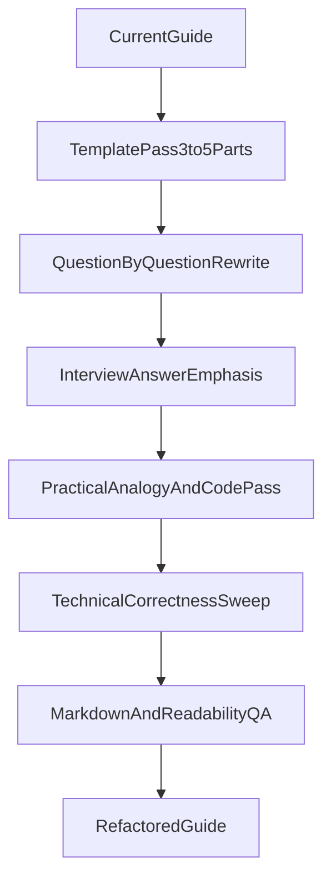

# Full Guide Refactor Plan

## Goals

- Restructure the entire guide for faster scanning and lower cognitive load.
- Replace rigid 5-part formatting with flexible templates (3/4/5 sections based on complexity).
- Make “what to say in interview” visually prominent and skimmable.
- Improve analogies/examples with mobile-app and software-engineering realism.

## Files in Scope

- Primary rewrite target: [c:\Users\trngs\Desktop\tarangnsharma\Interview Prep\Senior Flutter Interview Prep\Flutter-Senior-Interview-Rancho-Guide.md](c:/Users/trngs/Desktop/tarangnsharma/Interview%20Prep/Senior%20Flutter%20Interview%20Prep/Flutter-Senior-Interview-Rancho-Guide.md)
- Alignment reference: [c:\Users\trngs\Desktop\tarangnsharma\Interview Prep\Senior Flutter Interview Prep\Flutter-Senior-Interview-Rancho-Guide-Analysis.md](c:/Users/trngs/Desktop/tarangnsharma/Interview%20Prep/Senior%20Flutter%20Interview%20Prep/Flutter-Senior-Interview-Rancho-Guide-Analysis.md)
- Optional visual assets source: [c:\Users\trngs\Desktop\tarangnsharma\Interview Prep\website](c:/Users/trngs/Desktop/tarangnsharma/Interview%20Prep/website)

## Phase 1: Define New Authoring Pattern (global)

- Remove repetitive heading labels like “Industry Standard Question”.
- Standardize top format per question:
  - `## Qx: ...`
  - immediate italic interviewer prompt under it (no extra title block).
- Introduce flexible section templates:
  - **Light (3-part)** for simple concepts.
  - **Standard (4-part)** for medium complexity.
  - **Deep (5-part)** for advanced/system-level topics.
- Rename “Core Problem & Agnostic Logic” to concise “Core Problem”.

## Phase 2: Rewrite Ordering and Read Flow (entire file)

- Apply this preferred reading order for most questions:
  1. Prompt, 2) Core Problem, 3) Implementation / Concrete Example, 4) Interview Answer (“Say this”), 5) Optional Mental Model (only if it adds value).
- Merge “Mental Model” + “Implementation” when separate sections increase load.
- Keep section count adaptive by question complexity (no forced uniformity).

## Phase 3: Visual Emphasis for Interview Delivery

- Create a highly scannable “Say this in interview” block style using Markdown-safe emphasis:
  - strong lead-in labels (`What they test`, `Say this`, `Key line`).
  - short sentence chunks, bold keywords, inline code terms.
- Use syntax-highlighted code fences for spoken-answer snippets where useful (so VS Code theme colors naturally assist readability).
- Add one-line “Do not say” red-flag when helpful to prevent common interview mistakes.

## Phase 4: Improve Analogies and Examples (full document)

- Replace heavy metaphor-only explanations with practical domains:
  - mobile app lifecycle scenarios (background/foreground, cold start, network recovery),
  - production engineering scenarios (init sequence, DI bootstrapping, crash reporting),
  - architecture tradeoff examples from real Flutter workflows.
- Keep analogies concise and attach them to concrete code or execution order.
- Pull optional visuals from the `website` assets only where they clearly improve understanding (avoid decorative-only usage).

## Phase 5: Technical Correctness and Consistency Sweep

- Apply analysis-file improvements while rewriting:
  - tighten over-absolute statements (e.g., `ensureInitialized` nuance),
  - keep lifecycle states updated,
  - ensure snippets are compile-valid and internally consistent.
- Normalize tone and brevity:
  - screening-friendly answer length first,
  - deeper follow-up line second.

## Phase 6: QA and Final Validation

- Run a final pass for:
  - heading consistency,
  - reduced repetition,
  - clear interview-ready blocks per question,
  - no broken markdown/code fences.
- Deliver concise change summary and optionally stage a second pass for style polish if desired.

## Working Strategy

- Execute in controlled batches (question groups) to avoid regressions and keep quality high.
- After each batch: quick readability check + consistency check before moving forward.

