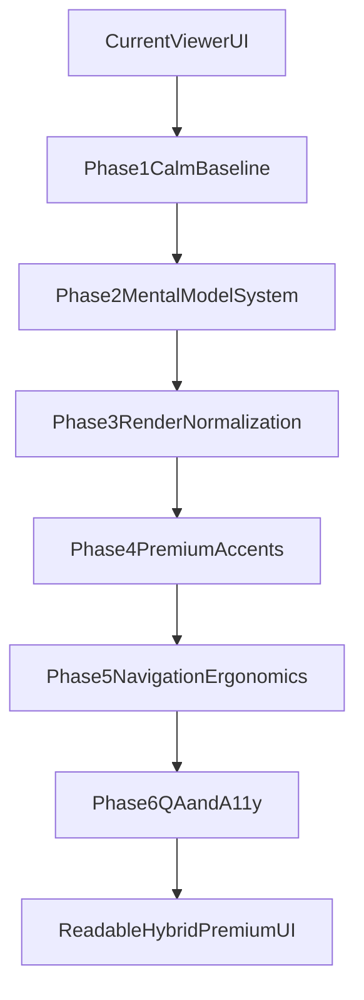

# Phased UI/UX Upgrade Plan

## Outcomes

- Make the viewer feel calm and premium at the same time (hybrid direction).
- Reduce cognitive load in scanning and long-form reading.
- Improve Mental Model readability without changing conceptual meaning.
- Remove visual harshness from em dashes and heavy inline emphasis through presentation-layer formatting.

## In-Scope Files

- Viewer logic: [c:\Users\trngs\Desktop\tarangnsharma\Interview Prep\Senior Flutter Interview Prep\guide-viewer\src\main.ts](c:/Users/trngs/Desktop/tarangnsharma/Interview%20Prep/Senior%20Flutter%20Interview%20Prep/guide-viewer/src/main.ts)
- Viewer styling: [c:\Users\trngs\Desktop\tarangnsharma\Interview Prep\Senior Flutter Interview Prep\guide-viewer\src\style.css](c:/Users/trngs/Desktop/tarangnsharma/Interview%20Prep/Senior%20Flutter%20Interview%20Prep/guide-viewer/src/style.css)
- Source markdown (read-only for structure awareness; no meaning changes): [c:\Users\trngs\Desktop\tarangnsharma\Interview Prep\Senior Flutter Interview Prep\Flutter-Senior-Interview-Rancho-Guide.md](c:/Users/trngs/Desktop/tarangnsharma/Interview%20Prep/Senior%20Flutter%20Interview%20Prep/Flutter-Senior-Interview-Rancho-Guide.md)

## Phase 1: Visual Baseline Reset (Calm Core)

- Simplify top header and controls into a quieter utility bar (priority controls first, secondary controls tucked into a compact menu).
- Rebalance page proportions: wider breathing margin, narrower reading column, subtler card borders/shadows.
- Normalize typography scale:
  - reduce heading weight spikes,
  - increase paragraph readability via consistent measure/line-height,
  - reduce bold intensity in body rendering.
- Rework TOC text density and spacing for scannability (shorter labels, better active-state contrast).

## Phase 2: Mental Model Readability System

- Keep Mental Model optional but redesign as low-noise “insight cards” with cleaner disclosure UI.
- Add presentation-layer text smoothing for Mental Model blocks only:
  - render-time substitution of em dash (`—`) to gentler separators (e.g., punctuation + spacing) without changing source meaning,
  - sentence-group line chunking to avoid long dense paragraphs and improve scan flow.
- Add alternate “Expanded prose” toggle for users who prefer uninterrupted paragraph mode.

## Phase 3: Content Representation Layer (No Meaning Change)

- Introduce renderer transforms (DOM-level, post-markdown render):
  - soften excessive inline emphasis by reducing visual dominance (font-weight/color),
  - maintain semantic emphasis but prevent bold-heavy wall-of-text.
- Add paragraph rhythm helpers:
  - max sentence group length per visual block,
  - consistent spacing between conceptual units.
- Ensure transforms are scoped and reversible (feature flags/classes), preserving original markdown source.

## Phase 4: Hybrid Premium Accents (Selective)

- Add restrained premium cues inspired by modern showcase sites:
  - subtle gradient progress indicator,
  - cleaner section dividers and chips,
  - refined motion for TOC/focus transitions.
- Avoid heavy hero dominance; prioritize reading over spectacle.

## Phase 5: Interaction and Navigation Ergonomics

- Improve focus mode into true “rehearsal mode”:
  - clear active question framing,
  - unobtrusive next/prev affordances,
  - visible shortcut hints.
- Enhance TOC collapse behavior with better left-edge docking and re-open discoverability.
- Add “jump back to current question” anchor when users scroll deep.

## Phase 6: QA, Accessibility, and Performance

- Validate readability on long sessions (desktop first, then responsive).
- Accessibility pass:
  - heading hierarchy,
  - keyboard reachability,
  - contrast targets,
  - reduced-motion compatibility.
- Performance pass:
  - keep interactions responsive with large markdown,
  - avoid layout jank from runtime transforms.

## Delivery Strategy

- Implement in small vertical slices and evaluate after each phase before moving forward.
- Keep each phase behind clear class/feature boundaries to allow quick rollback of any visual experiment.

